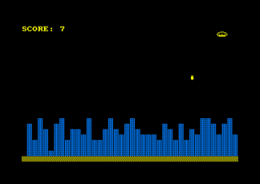
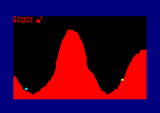
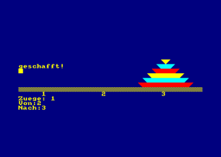
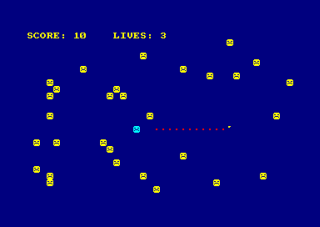
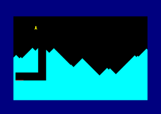
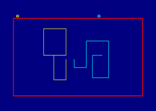

# 1kb-Games
A collection of small Amstrad-CPC games. Each game is not longer than 1kB (1024 bytes).

**Play them in the browser:** https://mikehesser.github.io/1kb-Games/play/

The original BASIC listings run there unchanged on a small Amstrad CPC emulation written in JavaScript (`play/cpc.js`).

## EMERGENCY

!!!!ALARM!!!! You as the captain of the spaceship ENTERPRISE just get the message that
while exploring the mountainous surface of the still relatively unknown planet PROXIMA 4-712Y
a meteorite has damaged the fuel tank. There is only one way out - to find a suitable
landing strip before the tank completely leaks. But unfortunately the 
fuel only reaches as far as an abandoned ruined city.

Your task now is to use bombs to destroy the city's buildings in order to create a landing strip.
to create a landing strip. Your spaceship flies from left to right across the screen and
Screen and constantly loses altitude. With the <SPACE> BUTTON you can drop unlimited bombs, but only one at a time.
but only one at a time!

It is advisable to always bomb the highest buildings, otherwise there will inevitably be a collision. Once you have landed safely, the next level comes,
but with the difference that your spaceship will sink even faster.
 
▶ [Play in the browser](https://mikehesser.github.io/1kb-Games/play/emergency/)

## Shooter
 
In this game two players try to destroy each other's ground cannon via a well-aimed shot. The trajectory of the projectile is determined by specifying the strength and angle of the shot, which also has to go over a mountain.
 
▶ [Play in the browser](https://mikehesser.github.io/1kb-Games/play/shooter/)

 
## The towers of Hanoi
 
The "Towers of Hanoi" is a well-known strategy game. The goal is to rebuild a tower consisting of stones in a different place by rearranging each stone. 
The rearrangement is done by specifying the position of the stone as well as the destination. The stone must not be larger than the stone at the destination.

▶ [Play in the browser](https://mikehesser.github.io/1kb-Games/play/hanoi/)

## Hunting
 
The goal of this game is simple: stay alive as long as possible! Try to avoid the vicious mice that are scattered all over the field. It is also forbidden to step on your own track that you leave behind. In addition, there is a hunting Miesmoppel that follows you at every turn. Fortunately there is still the screen edge to escape...

The game is controlled with the cursor keys.
 
▶ [Play in the browser](https://mikehesser.github.io/1kb-Games/play/hunting/)

 
## Moonlander

In this skill game, the player has the task of landing his space shuttle on a landing pad under the lunar surface. He can use the cursor keys to control the horizontal and vertical thrust.
Once the shuttle has been successfully brought to the landing site, the game starts all over again. With one difference: The tunnel is even narrower... 

* Cursor up: vertical thrust
* Cursor left: acceleration to the left
* Cursor right: acceleration to the right
 
▶ [Play in the browser](https://mikehesser.github.io/1kb-Games/play/moonlander/)

## Tron

A game for two players, based on the light cycle race from the movie "Tron". Both players drive across the screen and leave a trail behind them. Whoever crashes into a trail or into the wall loses the round: the screen flashes in the color of the loser and the other player gets a point. Then the next round starts.

With the turbo key a player moves two pixels in one step instead of one – this way you can even jump over a trail.

* Player 1 (yellow): cursor keys, turbo with SPACE
* Player 2 (cyan): W (up), Z (down), A (left), S (right), turbo with the small ENTER key

▶ [Play in the browser](https://mikehesser.github.io/1kb-Games/play/tron/)

## About the browser versions

`play/cpc.js` contains a small Locomotive BASIC interpreter together with the parts of the CPC that the games need:
MODE 1 with the 27-colour palette, text windows, PRINT/INPUT with control codes, graphics (PLOT, DRAW, TEST, TAG and XOR mode),
SOUND with its queue, EVERY interrupts, INKEY with the CPC key numbers and roughly the speed of the real machine.
The screen uses the original CPC character set.
After "Ready", Enter or a click starts the game again, Esc stops a running program.
