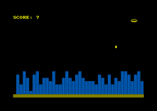
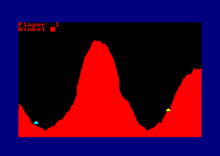
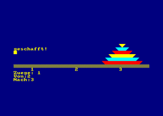
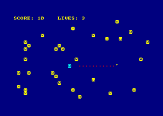
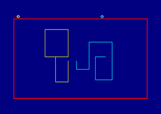

# 1kB-Games
Eine Sammlung kleiner Schneider-CPC Spiele. Jedes Spiel ist nicht länger als 1kB (1024 bytes).

## EMERGENCY

!!!!ALARM!!!! Sie als Kapitän des Raumschiffs KENTERPRISE bekommen gerade die Meldung, dass
beim Erforschen der gebirgigen Oberfläche des noch relativ unbekannten Planeten PROXIMA 4-712Y
ein Meteorit den Treibstofftank beschädigt hat. Es gibt nur einen Ausweg - eine geeignete
Landebahn zu finden, bevor der Tank völlig ausläuft. Doch unglücklicherweise reicht der 
Treibstoff nur noch bis zu einer verlassenen Ruinenstadt.

Ihre Aufgabe ist es nun, mit Bomben gezielt die Gebäude der Stadt zu zerstören, um sich
eine Landebahn zu schaffen. Dabei fliegt Ihr Raumschiff von links nach rechts über den
Bildschirm und verliert ständig an Höhe. Mit der <SPACE>-TASTE können Sie unbegrenzt Bomben
abwerfen, aber immer nur eine gleichzeitg!

Es ist ratsam, immer die höchsten Gebäude zu bombardieren,
sonst kommt es unweigerlich zur Kollision. Sind Sie sicher gelandet, kommt der nächste Level,
aber mit dem Unterschied, daß Ihr Raumschiff noch schneller sinkt.
 

## Shooter
 
In diesem Spiel versuchen zwei Spieler gegenseitig ihre Bodenkanone über einen gezielten Schuss zu zerstören. Über die Angabe der Schussstärke und des Schusswinkels wird die Flugbahn des Geschosses bestimmt, die zudem über einen Berg führen muss.
 

 
## Die Türme von Hanoi
 
Die "Türme von Hanoi" ist ein bekanntes Strategiespiel. Ziel ist es, ein Turm bestehend aus Steinen an einem anderen Ort neu aufzubauen indem jeder einzelne Stein umgeschichtet wird. 
Die Umschichtung erfolgt über die Angabe der Position des Steines sowie des Zielortes. Dabei darf der Stein nicht größer als der Stein am Zielort sein.

## Hunting
 
Das Ziel bei diesem Spiel ist einfach: Solange wie möglich am Leben bleiben! Versuche den bösartigen Miesemoppeln auszuweichen die auf dem ganzen Feld verstreut sind. Verboten ist auch die eigene Spur zu betreten die man hinterlässt. Dazu kommt noch ein jagender Miesmoppel hinzu der einen auf Schritt und Tritt verfolgt. Zum Glück gibt es ja noch den Bildschirmrand zum Flüchten...

Die Steuerung erfolgt über die Cursortasten.
 

 
## Moonlander

Bei diesem Geschicklichkeitsspiel hat der Spieler die Aufgabe, seine Raumfähre auf einem Landeplatz unter der Mondoberfläche zu landen. Dabei kann er über die Cursortasten den horizontalen und den vertikalen Schub regeln.
Hat man die Fähre erfolgreich an den Landeplatz gebracht fängt das ganze von vorne an. Mit einem Unterschied: Der Tunnel ist noch schmäler... 

Cursor oben: Schub vertikal
Cursor links: Beschleunigung nach links
Cursor rechts: Beschleunigung nach rechts
 

## Tron

Ein Spiel für zwei Spieler nach dem Lichtrad-Rennen aus dem Film "Tron". Beide Spieler fahren über den Bildschirm und ziehen dabei eine Spur hinter sich her. Wer gegen eine Spur oder gegen die Wand fährt, verliert die Runde: Der Bildschirm blinkt in der Farbe des Verlierers und der andere Spieler bekommt einen Punkt. Dann beginnt die nächste Runde.

Mit der Turbo-Taste kommt man in einem Schritt zwei Pixel statt einem voran – so kann man sogar über eine Spur springen.

* Spieler 1 (gelb): Cursortasten, Turbo mit der SPACE-Taste
* Spieler 2 (türkis): W (oben), Z (unten), A (links), S (rechts), Turbo mit der kleinen ENTER-Taste

